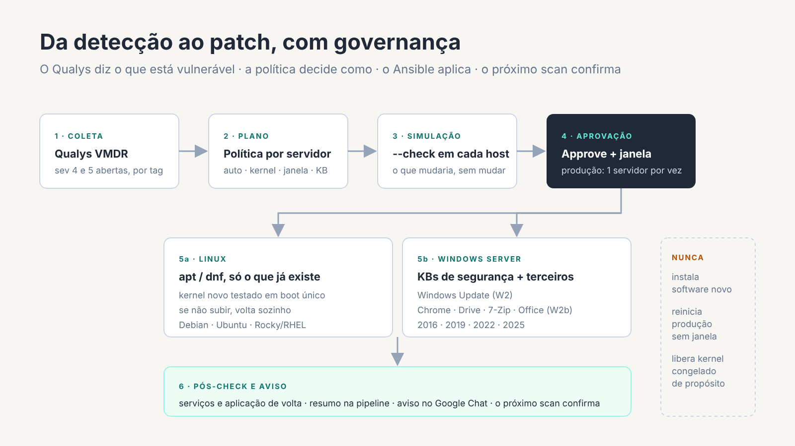
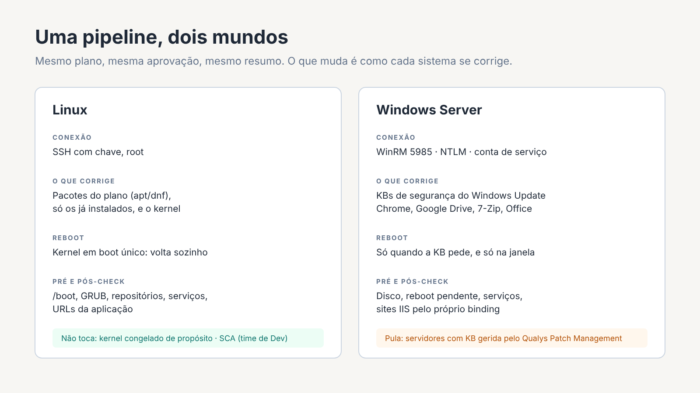
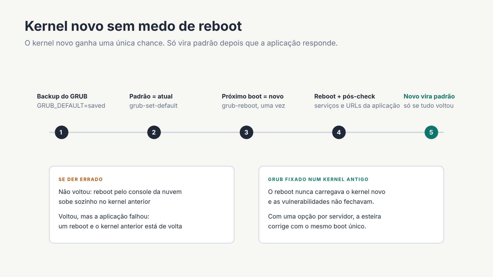

# governed-patch-management

**Patch Linux e Windows Server guiado pelo Qualys, com Ansible e Azure DevOps — com plano, simulação, aprovação e volta automática.**
**Qualys-driven patching for Linux and Windows Server with Ansible and Azure DevOps — plan, dry-run, approval and automatic rollback.**

[Português](#português) · [English](#english)



---

## Português

### Por que existe

Scanner de vulnerabilidade mostra o problema; quem fecha é o patch. Na prática, o patch mensal "atualiza tudo e reza",
reinicia produção na hora errada e, mesmo assim, deixa vulnerabilidade aberta: kernel instalado que nunca carregou,
GRUB preso num kernel antigo, Chrome instalado por usuário, servidor que o agendamento não alcança.

Esta esteira inverte a lógica: **o Qualys diz o que está vulnerável, uma política decide como corrigir, o Ansible aplica
só aquilo, e o próximo scan confirma**. Tudo numa pipeline com simulação antes, aprovação em produção, um servidor por vez
e aviso no Google Chat no final.

### O que faz

| | 🐧 Linux | 🪟 Windows Server |
|---|---|---|
| Distribuições / versões | Debian 11/12, Ubuntu 20.04–24.04, Rocky/RHEL 8/9 | 2016, 2019, 2022, 2025 |
| Conexão | SSH com chave (root) | WinRM 5985 / NTLM, conta de serviço do domínio |
| O que corrige | Pacotes apontados pelo Qualys (`apt`/`dnf`, **só os já instalados**) e o **kernel** | **W2**: KBs de segurança do Windows Update · **W2b**: Chrome, Google Drive, 7-Zip, Office ClickToRun |
| Reboot | Kernel novo em **boot único**: se não subir, volta sozinho para o anterior | Só quando a KB pede e só na janela; nunca reinicia só por W2b |
| Pré e pós-check | `/boot`, GRUB, repositórios, serviços habilitados, serviços e URLs da aplicação | Disco, reboot pendente, serviços, sites IIS testados pelo próprio binding |
| Não toca | Kernel congelado de propósito, bibliotecas de aplicação (SCA) | Servidores com KB gerida pelo **Qualys Patch Management** (detectados pela GPO) |



### Como funciona

1. **Coleta** (`scripts/qualys_coleta.py`): Host Detection API do Qualys, só detecções abertas de severidade 4 e 5 das tags do
   escopo, com pacote, versão instalada e exigida. Categoria de cada QID pela KnowledgeBase; **SCA fica de fora** (é do time de Dev).
2. **Plano** (`scripts/gerar_plano.py` + `policy/policy.yml`): cada pacote ganha uma rota — `AUTO`, `KERNEL`, `JANELA`
   (protegidos: web server, banco, runtime), `REMOVER` ou `MANUAL`. Windows é classificado por tipo de correção:
   KB, produto Microsoft, terceiros ou configuração.
3. **Simulação** (`--check`): entra em cada servidor, faz todos os pré-checks e lista **pacote: versão atual → nova**,
   kernel e GRUB (Linux) ou **cada KB e produto do W2b** (Windows). Nada muda.
4. **Aplicação**: não-produção primeiro; produção com **Approve** no environment, **janela** marcada e **1 servidor por vez**
   (nunca dois controladores de domínio juntos). Para no primeiro erro.
5. **Resumo e aviso**: tabela na aba *Summary* da run, artefatos JSON por servidor e mensagem no **Google Chat**.



### Proteções que fazem diferença

- **Só atualiza o que já existe** (`only_upgrade` / `update_only`): nunca instala pacote novo por engano.
- **Kernel em boot único** (`grub-reboot`): o padrão continua no kernel atual até o pós-check passar.
- **GRUB fixado num kernel antigo**: detectado já na simulação; com `patch_corrigir_grub_fixado: true` a esteira corrige com o mesmo boot único.
- **Kernels antigos** que o Qualys acusa mesmo fora de uso: `patch_remover_kernels_antigos` remove só versões abaixo da exigida, nunca a em uso.
- **Kernel congelado de propósito** (`apt-mark hold`): `patch_kernel_congelado` com o motivo; a esteira nunca libera.
- **Outro apt rodando**: espera o lock (`patch_apt_lock_timeout`) e, se não liberar, para mostrando PID e comando.
- **Health check da aplicação** por servidor (`host_vars`): serviços, URLs e sites IIS precisam estar no ar **antes** e **depois**.
- **Windows**: produção sem janela não instala nada; reboot pendente só é resolvido quando há KB a instalar;
  fonte do Windows Update bloqueada → tenta Microsoft Update e WSUS e mostra a GPO.
- **Serviços que já falhavam antes** aparecem separados dos que **passaram a falhar depois** — a esteira não leva a culpa do que já estava quebrado.

### Estrutura

```
├── azure-pipelines.yml          # 0 Descoberta · 1 Plano · 2 Patch não-prod · 3 Patch prod (Linux e Windows)
├── policy/policy.yml            # rotas por pacote (Linux) e servidores "fora do inventário" já explicados
├── inventories/                 # EXEMPLOS: hosts.yml (Linux), windows.yml, group_vars, host_vars
├── playbooks/                   # aplicar_linux, aplicar_windows, descobrir_servicos (Linux e Windows)
├── roles/patch_linux/           # apt/dnf, kernel, GRUB e boot único, pré/pós-check
├── roles/patch_windows/         # W2 Windows Update + W2b terceiros/Office, pré/pós-check, IIS
├── scripts/                     # coleta, plano, resumo, aviso no Google Chat, diagnóstico do host
└── tests/                       # parser do Qualys, política, plano e validação dos host_vars
```

### Como usar

**1. Azure DevOps** (Pipelines → Library e Environments):

| Item | Conteúdo |
|---|---|
| Variable group `qualys-api` | `QUALYS_USER`, `QUALYS_PASS` (secret) e, opcional, `PATCH_CHAT_WEBHOOK` (secret) |
| Variable group `windows-credentials` | `DOMAIN_USER`, `DOMAIN_PASS` (secret) — conta de serviço com admin local nos Windows |
| Secure file `ssh_key_ansible` | Chave privada SSH do Ansible (a pública no `authorized_keys` do root) |
| Environments | `patch-nao-producao` (sem aprovação) e `patch-producao` (**com Approvals**) |
| Agent pool | `self-hosted-ansible` — um agente Linux com Python 3 que alcança os servidores (22 e 5985) |

Ajuste `QUALYS_API_URL` no `azure-pipelines.yml` para a URL de API da sua plataforma Qualys.

**2. Inventário**: troque os exemplos de `inventories/` pelos seus servidores (IP igual ao do Qualys) e rode o modo
**🔍 Descobrir serviços** para gerar a sugestão de `host_vars` de cada um.

**3. Rodar**: *Run pipeline* → **⚙️ Executar patch** → **💻 linux / windows / ambos** → **🧪 Simular** (padrão) →
**🎯 Ambiente** → **🔎 Limitar a hosts**. Revise o *Summary*, faça o snapshot e rode de novo com 🧪 desmarcado
(produção: 🪟 janela + Approve).

**Checklist de servidor novo**

| Linux | Windows |
|---|---|
| Tag no Qualys | Tag no Qualys e servidor no domínio |
| SSH 22 liberado a partir do agente | WinRM HTTP 5985 ligado (`Enable-PSRemoting -Force`) e liberado a partir do agente |
| `PermitRootLogin prohibit-password` e chave pública no root | Conta de serviço no grupo Administradores local, sem bloqueio de logon de rede |
| Python 3, apt/dnf funcionando, espaço em `/boot` | PowerShell 5.1, 10 GB livres no C:, saída HTTPS para Windows Update e instaladores do W2b |
| GRUB em `0` ou `saved` (ou `patch_corrigir_grub_fixado`) | `host_vars` com serviços críticos e sites IIS |

Teste: `ansible -i inventories/hosts.yml <host> -m ping` · `ansible -i inventories/windows.yml <host> -m ansible.windows.win_ping`.

**Rodar local**

```bash
python3 -m venv .venv && . .venv/bin/activate && pip install -r requirements.txt
python -m unittest discover -s tests -v
export QUALYS_USER=... QUALYS_PASS=... QUALYS_API_URL=https://qualysapi.<sua-plataforma>.apps.qualys.com
python scripts/qualys_coleta.py && python scripts/gerar_plano.py && cat out/resumo.md
ansible-playbook playbooks/aplicar_linux.yml --check -e alvo=nao_producao --limit web-hml-01 --private-key <chave>
```

### Resultados reais (ambiente de produção que originou o projeto)

- Kernel novo carregado em servidores que estavam com o **GRUB preso** num kernel antigo havia meses.
- **131 vulnerabilidades** fechadas num servidor Debian só removendo kernels antigos que nem estavam em uso.
- Chrome atualizado em **controladores de domínio** sem reiniciar produção.
- Três pipelines legados de patch pausados (um deles era duplicado e rodava duas vezes por mês).

### Segurança

Nenhum segredo no repositório: credenciais do Qualys, do domínio e do webhook só em variáveis **secret** do Azure DevOps,
passadas por variável de ambiente (nunca na linha de comando). O usuário do Qualys pode ser **somente leitura**.
Instaladores do W2b vêm **só dos sites oficiais** dos fornecedores.

---

## English

### Why

A vulnerability scanner shows the problem; patching closes it. In real life, the monthly patch job "updates everything
and hopes", reboots production at the wrong time and still leaves findings open: a kernel installed but never loaded,
GRUB pinned to an old kernel, Chrome installed per user, servers the schedule never reaches.

This pipeline flips it around: **Qualys says what is vulnerable, a policy decides how to fix it, Ansible applies only that,
and the next scan confirms it** — with a dry-run first, approval for production, one server at a time and a Google Chat
notification at the end.

### What it does

| | 🐧 Linux | 🪟 Windows Server |
|---|---|---|
| Versions | Debian 11/12, Ubuntu 20.04–24.04, Rocky/RHEL 8/9 | 2016, 2019, 2022, 2025 |
| Connection | SSH key (root) | WinRM 5985 / NTLM, domain service account |
| Fixes | Packages flagged by Qualys (`apt`/`dnf`, **already installed only**) and the **kernel** | **W2**: Windows Update security KBs · **W2b**: Chrome, Google Drive, 7-Zip, Office Click-to-Run |
| Reboot | New kernel in a **one-time boot**: falls back to the previous one if it does not come up | Only when a KB requires it and only in the maintenance window |
| Pre/post checks | `/boot`, GRUB, repositories, enabled services, app services and URLs | Disk, pending reboot, services, IIS sites tested through their own binding |
| Leaves alone | Kernels held on purpose, application libraries (SCA) | Servers whose KBs are handled by **Qualys Patch Management** (detected from GPO) |

### How it works

1. **Collect** — Qualys Host Detection API, open severity 4/5 findings for the scoped tags, with package and versions; SCA is excluded.
2. **Plan** — each package gets a route from `policy/policy.yml`: `AUTO`, `KERNEL`, `JANELA` (window: web servers, databases, runtimes), `REMOVER` (remove) or `MANUAL`. Windows findings are classified as KB, Microsoft product, third party or configuration.
3. **Dry-run** (`--check`) — every pre-check runs and the summary lists package: current → new version, kernel and GRUB, or each KB and W2b product.
4. **Apply** — non-production first; production needs **Approve**, the **window** flag and runs **one server at a time**. Stops at the first error.
5. **Report** — run *Summary*, JSON per server and a **Google Chat** message.

### Getting started

1. Azure DevOps: variable groups `qualys-api` (`QUALYS_USER`, `QUALYS_PASS`, optional `PATCH_CHAT_WEBHOOK`) and
   `windows-credentials` (`DOMAIN_USER`, `DOMAIN_PASS`), secure file `ssh_key_ansible`, environments `patch-nao-producao`
   and `patch-producao` (with approvals), agent pool `self-hosted-ansible`. Set `QUALYS_API_URL` for your Qualys platform.
2. Replace the example inventories with your servers (same IP as in Qualys) and run the **🔍 Discover services** mode to draft each `host_vars`.
3. *Run pipeline* → **Execute patch** → system (`linux` / `windows` / `ambos` = both) → **Simulate** (default) → environment → limit hosts. Review, snapshot, then run for real.

The code, comments and pipeline labels are in Portuguese; variable names are self-explanatory and every option is
documented in the role defaults (`roles/*/defaults/main.yml`).

### Real-world results

- A new kernel finally loaded on servers whose **GRUB was pinned** to an old one for months.
- **131 findings** closed on a Debian server just by removing old, unused kernel packages.
- Chrome updated on **domain controllers** with no production reboot.
- Three legacy patch pipelines paused (one was a duplicate running twice a month).

---

**Autor / Author:** [Kelsen Lima](https://www.linkedin.com/in/kelsenlima) · Head de TI · Oracle ACE Apprentice ·
[Blog](https://planningit.wordpress.com) · Licença / License: [MIT](LICENSE)
